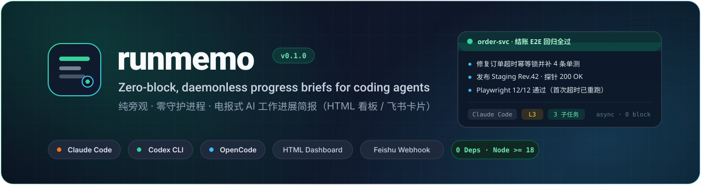
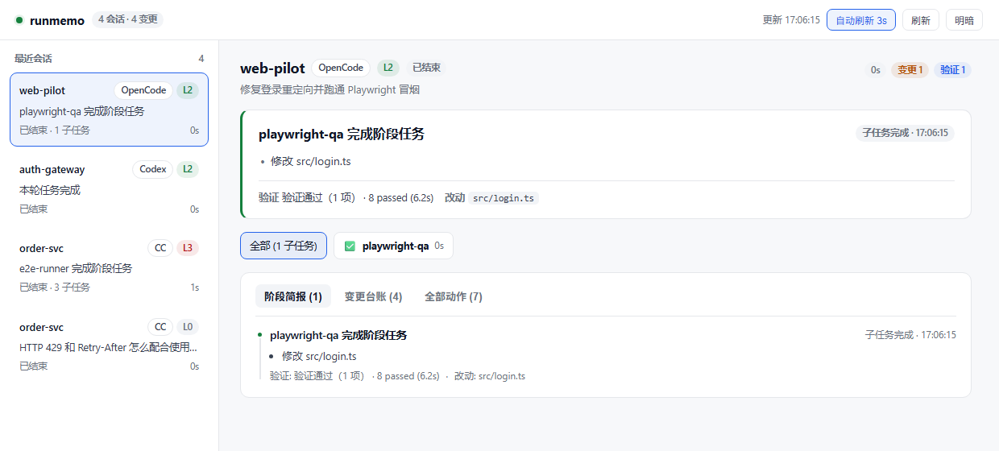
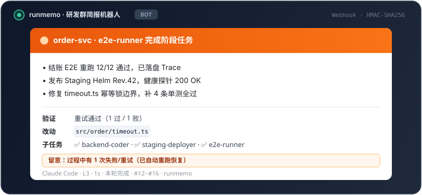
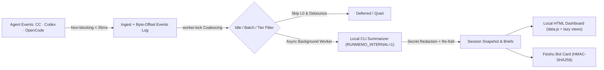

<div align="center">

<picture>
  
</picture>

<br />
<br />

<p>
  <a href="https://github.com/yzxz1996/runmemo/actions/workflows/ci.yml">
    
  </a>
  = 18" />
  
  
  <a href="./LICENSE">
    
  </a>
</p>

<p>
  <strong>简体中文</strong> · <a href="./README_EN.md">English</a>
</p>

<p>
  <strong>零拦截、零守护进程、电报式精炼</strong> 的 Coding Agent 阶段进展简报工具。<br />
  在 AI 写代码、跑测试、发布或派发多子 Agent 时，异步把过程提炼成 <strong>3 秒扫完的短简报</strong>，推送到本地 HTML 面板或飞书群机器人。
</p>

</div>

---

## 效果预览

### 本地自动刷新 HTML 面板

零后端服务器，直接双端分块按需加载，支持切换暗色模式、子任务节点筛选、变更台账与全量动作流水（切到后台标签页自动暂停轮询省电）：

<p align="center">
  
</p>

### 飞书群 Webhook 交互卡片

自动省略空字段，支持按阶段状态智能着色、子任务进度条与 HMAC-SHA256 签名校验：

<p align="center">
  
</p>

### 实时扫描本机 Agent 并交互安装

只做纯文件系统/配置与 `PATH` 扫描，**不启动任何外部 CLI 进程**：

```text
$ runmemo install
实时检测到 3/3 个受支持 Agent [范围: user (全局)]：
  [1] Claude Code (cc) — 已安装 (claude)     [钩子: 未安装]
  [2] Codex CLI (codex) — 已安装 (codex)     [钩子: 未安装]
  [3] OpenCode (opencode) — 已安装 (opencode) [钩子: 未安装]

请选择要安装的 Agent [序号/名称，逗号分隔；回车安装全部 3 项；q 取消]: 1,2
✅ [Claude Code] 已安装纯旁观 Hooks (user)
✅ [Codex CLI] 已安装纯旁观 Hooks (user)
   已自动开启特性: ~/.codex/config.toml (codex_hooks = true)
```

---

## 核心特性

- **纯旁观、绝对无感**：只挂载后置观测钩子 / 原生事件监听，永不拦截或阻塞 Agent 主循环；触发器立即后台落盘退出（`< 35ms` 热路径）。
- **实时检测、一键接管**：`runmemo detect` 与 `runmemo install` 实时探测本机已安装的 **Claude Code**、**Codex CLI** 与 **OpenCode**（含全局/项目双作用域），自动备份原配置（`*.runmemo.bak`），卸载干净不伤原有设置。
- **直接复用本机 CLI 做概括**：`cli` 设为 `auto` 时优先复用当前会话所属工具 CLI（也可固定 `claude` / `codex` / `opencode`），内置 `RUNMEMO_INTERNAL=1` 防递归防爆，无需额外 API Key（已预留自定义 `api` 扩展位）。
- **零守护进程、零外部依赖**：纯 Node.js（`>= 18`）原生 ESM 实现，基于 UTF-8 换行对齐字节偏移做 `O(Δ)` 增量物化，多会话采用分段锁防止并发覆盖。
- **克制、低噪的简报策略**：1 句状态标题 + 1~3 条短要点，自动跳过 L0 闲聊、折叠连续只读操作并做内置密钥脱敏（`Bearer` / `sk-` / `ghp_` / `AKIA...` 等）。

---

## 支持矩阵

| Coding Agent | 安装方式 | 覆盖能力 |
| :--- | :--- | :--- |
| **Claude Code** (`cc`) | `~/.claude/settings.json`（Pure passive Hooks） | 会话生命周期、用户提问、工具变更/失败、子任务树 (`SubagentStart`/`Stop`) |
| **OpenAI Codex CLI** (`codex`) | `~/.codex/hooks.json` + 自动开启 `[features] codex_hooks = true` | 会话生命周期、Shell/工具验证、`apply_patch` 多文件改动解析、子任务树 |
| **OpenCode** (`opencode`) | `~/.config/opencode/plugins/runmemo.js`（原生 ESM 插件） | 进程内事件/Tool Hooks、`parentID` 父子会话递归归并、无感零依赖注入 |
| **Antigravity** (`agy`) | *v2 规划中* | 当前版本 `runmemo detect` 可识别提示，安装流程将在后续版本开放 |

---

## 工作原理



---

## 1 分钟快速开始

### 1. 安装 CLI（无需 `npm install`，零外部依赖）

```bash
git clone https://github.com/yzxz1996/runmemo.git
cd runmemo
npm link
```

> 也可直接从 GitHub 安装：`npm install -g git+https://github.com/yzxz1996/runmemo.git`（或直接用 `node ./bin/runmemo.mjs <命令>`）。

### 2. 检测并挂载钩子

```bash
# 方式一（推荐）：自动检测本机已安装的 Agent 并交互挑选
runmemo install

# 或先查看实时检测结果，再一键全部安装 / 按需安装项目级钩子
runmemo detect
runmemo install -y
runmemo install --scope project
```

### 3. 配置输出方式与概括引擎

```bash
# 启动交互式配置向导
runmemo config init

# 或直接使用命令行修改
runmemo config set output html,feishu
runmemo config set cli auto              # auto | claude | codex | opencode
runmemo config set feishu.webhook https://open.feishu.cn/open-apis/bot/v2/hook/<token>
runmemo config set feishu.secret <可选签名密钥>
```

### 4. 查看面板与离线演示

```bash
runmemo open         # 打开本地 HTML 面板（每 3s 增量静默刷新）
runmemo demo         # 离线模拟 CC / Codex / OpenCode 多会话（不调用真实 CLI）
runmemo feishu-test  # 发送一张测试卡片验证飞书群机器人连通性与签名
```

---

## 命令与配置速查

| 命令 | 说明 |
| :--- | :--- |
| `runmemo detect [--scope user\|project] [--json] [--install]` | 实时扫描本机已安装的 Agent 与钩子状态，加 `--install` 可直接安装 |
| `runmemo install [<cc\|codex\|opencode\|all>] [-y] [--dry-run]` | 交互挑选或按指定目标安装钩子/插件（自动生成 `.runmemo.bak` 备份） |
| `runmemo uninstall [<cc\|codex\|opencode\|all>]` | 干净卸载 `runmemo` 托管项，完整保留用户原有配置 |
| `runmemo config [show \| init \| set <k> <v> \| unset <k>]` | 查看（自动脱敏）、向导配置或修改单项参数 |
| `runmemo status` | 总览三端安装状态、输出通道与会话计数 |
| `runmemo doctor` | 实时排查 Node 版本、CLI 路径可用性与配置健康度 |
| `runmemo open` | 在默认浏览器打开本地 HTML 面板 |
| `runmemo demo [--send-feishu]` | 离线生成完整多端多子任务演示数据与预览卡片 |
| `runmemo feishu-test` | 向飞书 Webhook 发送测试卡片 |

<details>
<summary><strong>展开查看全部常用配置项（<code>runmemo config set &lt;key&gt; &lt;value&gt;</code>）</strong></summary>

| Key | 默认值 | 说明 |
| :--- | :--- | :--- |
| `output` / `outputs` | `html` | 输出通道：`html`、`feishu` 或 `html,feishu` |
| `cli` | `auto` | 概括引擎：`auto`（优先匹配触发来源 Agent）、`claude`、`codex`、`opencode` |
| `model` / `claude.model` | `haiku` | Claude Code CLI 概括所用模型 |
| `codex.model` | `""` | Codex CLI 概括所用模型（留空使用 Codex 默认） |
| `opencode.model` | `""` | OpenCode CLI 概括模型（如 `openai/gpt-4o-mini`） |
| `claude.bin` / `codex.bin` / `opencode.bin` | `claude` / `codex` / `opencode` | 自定义本机 CLI 可执行路径 |
| `html.dir` | `~/.runmemo` | 自定义 HTML 面板与索引数据输出目录 |
| `feishu.webhook` | `""` | 飞书自定义机器人 Webhook 地址 |
| `feishu.secret` | `""` | 飞书机器人可选加签密钥（HMAC-SHA256） |
| `feishu.minIntervalSec` | `60` | 同一会话非终止状态飞书推送节流最小间隔（秒） |
| `trigger.intervalSec` | `45` | 后台批量概括最小时间间隔（秒） |
| `trigger.batch` | `8` | 累计多少条关键事件触发一次阶段简报 |
| `trigger.skipL0` | `true` | 是否自动跳过无工具修改/执行的纯闲聊会话 |

</details>

---

## 安全与隐私设计

- **永不阻断、永不越权**：不挂 `PreToolUse` 拦截器；stdio Hook 始终以退出码 `0` 迅速结束，OpenCode 插件全部包裹容错边界。
- **防递归套娃**：异步概括子进程强制注入 `RUNMEMO_INTERNAL=1`，所有 Hook 在动态加载重模块之前即秒退。
- **敏感信息自动脱敏**：在送入概括器与落盘输出前自动遮蔽 `Bearer` 令牌、`sk-`、`ghp_`、`github_pat_`、`AKIA...`、`xoxb-...` 与常见密码字段。
- **可逆修改、零遥测**：安装配置优先写入 `.runmemo.bak` 备份并使用原子写替换；本工具不采集或上传任何遥测数据（仅当你显式开启 `feishu` 并填写 Webhook 时向飞书发送简报）。

---

## 本地测试与参与贡献

```bash
# 运行全部离线回归测试（全部在临时隔离目录运行，绝不执行真实 CLI，不改动本机配置）
npm test
```

欢迎提交 Issue 或 Pull Request！详情请参阅 [CONTRIBUTING.md](./CONTRIBUTING.md)、[CHANGELOG.md](./CHANGELOG.md) 与 [SECURITY.md](./SECURITY.md)。

## 开源协议

基于 [MIT License](./LICENSE) 开源。
