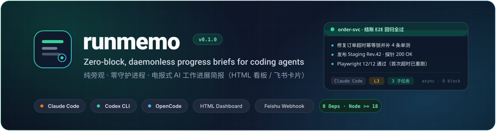
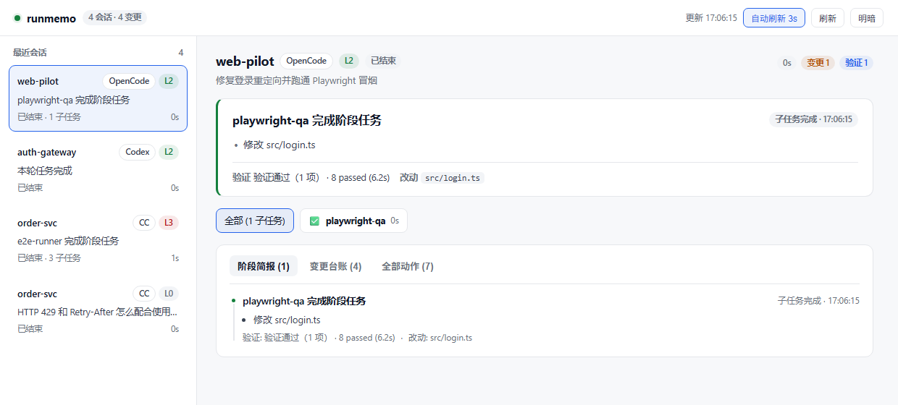
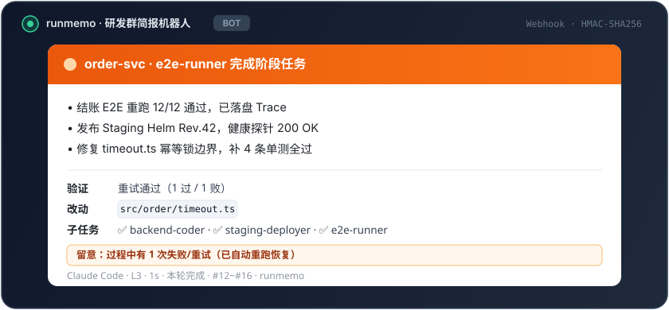
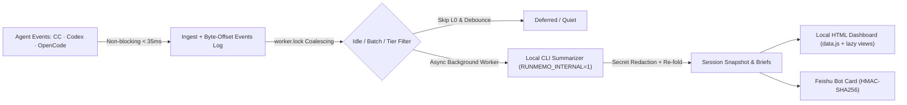

<div align="center">

<picture>
  
</picture>

<br />
<br />

<p>
  <a href="https://github.com/yzxz1996/runmemo/actions/workflows/ci.yml">
    
  </a>
  = 18" />
  
  
  <a href="./LICENSE">
    
  </a>
</p>

<p>
  <a href="./README.md">简体中文</a> · <strong>English</strong>
</p>

<p>
  <strong>Zero-block, daemonless, telegraphic progress briefs</strong> for coding agents.<br />
  Observe multi-step edits, test runs, and subagent trees asynchronously without slowing down the agent loop, then stream concise digests to a local HTML dashboard or Feishu group bot.
</p>

</div>

---

## Preview

### Auto-Refreshing Local HTML Dashboard

No background server required—lazy per-session JS views load on demand, with dark mode toggle, subagent filtering, file-change ledger, and automatic polling pause when the tab is hidden:

<p align="center">
  
</p>

### Feishu / Lark Webhook Interactive Card

Omits empty placeholder fields, color-codes status transitions, displays subagent progress, and supports HMAC-SHA256 webhook signing:

<p align="center">
  
</p>

### Real-Time Local Agent Detection & Interactive Install

Pure filesystem, config directory, and `PATH` inspection—**never executes external agent binaries**:

```text
$ runmemo install
Detected 3/3 supported agents in real time [scope: user]:
  [1] Claude Code (cc) — installed (claude)     [hook: not installed]
  [2] Codex CLI (codex) — installed (codex)     [hook: not installed]
  [3] OpenCode (opencode) — installed (opencode) [hook: not installed]

Select agents to install [index/name, comma-separated; Enter = all 3; q = cancel]: 1,2
✅ [Claude Code] Passive hooks installed (user)
✅ [Codex CLI] Passive hooks installed (user)
   Enabled feature flag in ~/.codex/config.toml (codex_hooks = true)
```

---

## Key Features

- **Zero-Block Passive Observation**: Hooks run strictly post-event (`exit 0`, `< 35ms` hot path), never intercepting or gating tool execution.
- **Real-Time Detection & Safe Installers**: `runmemo detect` and `runmemo install` automatically discover installed **Claude Code**, **Codex CLI**, and **OpenCode** setups (user or project scope), create `.runmemo.bak` backups before writing, and uninstall cleanly.
- **Reuses Your Local Agent CLI**: With `cli=auto`, summarizes via the originating agent CLI (or lock to `claude` / `codex` / `opencode`). Includes `RUNMEMO_INTERNAL=1` recursion guard—no extra API keys needed (`api` provider slot reserved for future release).
- **Daemonless & Zero Dependencies**: Pure Node.js (`>= 18`) ESM modules using `O(Δ)` UTF-8 newline-aligned byte-offset incremental materialization and cross-session file locking.
- **Telegraphic, Low-Noise Briefs**: 1 crisp headline + 1–3 high-signal bullets per milestone; skips L0 chitchat, collapses consecutive reads, and masks secrets (`Bearer`, `sk-`, `ghp_`, `AKIA...`, etc.).

---

## Supported Agents

| Coding Agent | Integration Mechanism | Captured Signals |
| :--- | :--- | :--- |
| **Claude Code** (`cc`) | `~/.claude/settings.json` (passive command hooks) | Session lifecycle, prompts, tool edits/failures, `SubagentStart`/`Stop` trees |
| **OpenAI Codex CLI** (`codex`) | `~/.codex/hooks.json` + `[features] codex_hooks = true` | Session lifecycle, shell checks, `apply_patch` multi-file extraction, subagents |
| **OpenCode** (`opencode`) | `~/.config/opencode/plugins/runmemo.js` (ESM plugin) | In-process events & tool hooks, `parentID` sub-session merging |
| **Antigravity** (`agy`) | *Planned (v2)* | Reported in `runmemo detect` output; installer planned for next milestone |

---

## Architecture



---

## Quick Start

### 1. Install CLI (Zero Dependencies)

```bash
git clone https://github.com/yzxz1996/runmemo.git
cd runmemo
npm link
```

> Or install directly from GitHub: `npm install -g git+https://github.com/yzxz1996/runmemo.git` (or run `node ./bin/runmemo.mjs <command>` directly).

### 2. Detect & Install Hooks

```bash
# Auto-detect installed agents and pick interactively
runmemo install

# Or inspect first / install non-interactively / scope to a single project
runmemo detect
runmemo install -y
runmemo install --scope project
```

### 3. Configure Outputs & Summarizer CLI

```bash
runmemo config init

# Or set keys directly
runmemo config set output html,feishu
runmemo config set cli auto              # auto | claude | codex | opencode
runmemo config set feishu.webhook https://open.feishu.cn/open-apis/bot/v2/hook/<token>
runmemo config set feishu.secret <optional-signing-secret>
```

### 4. View Dashboard & Offline Demo

```bash
runmemo open         # Open auto-refreshing HTML dashboard in default browser
runmemo demo         # Generate multi-agent offline demo (never invokes real CLIs)
runmemo feishu-test  # Send a test card to verify Feishu webhook & signature
```

---

## Commands & Configuration

| Command | Description |
| :--- | :--- |
| `runmemo detect [--scope user\|project] [--json] [--install]` | Scan local agents and hook statuses in real time; add `--install` to install directly |
| `runmemo install [<cc\|codex\|opencode\|all>] [-y] [--dry-run]` | Detect and interactively install (or target directly), backing up prior configs |
| `runmemo uninstall [<cc\|codex\|opencode\|all>]` | Remove only `runmemo`-managed hooks/plugins cleanly |
| `runmemo config [show \| init \| set <k> <v> \| unset <k>]` | Inspect masked config, run setup wizard, or update individual keys |
| `runmemo status` | Show user/project hook status, output sinks, and session count |
| `runmemo doctor` | Check Node version, non-executing CLI availability, and hook readiness |
| `runmemo open` | Open the local HTML dashboard |
| `runmemo demo [--send-feishu]` | Simulate CC, Codex, and OpenCode sessions completely offline |
| `runmemo feishu-test` | Push a sample card to verify Feishu webhook connectivity |

<details>
<summary><strong>Full Configuration Keys (<code>runmemo config set &lt;key&gt; &lt;value&gt;</code>)</strong></summary>

| Key | Default | Description |
| :--- | :--- | :--- |
| `output` / `outputs` | `html` | Sinks: `html`, `feishu`, or `html,feishu` |
| `cli` | `auto` | Summarizer CLI: `auto`, `claude`, `codex`, `opencode` |
| `model` / `claude.model` | `haiku` | Claude CLI model |
| `codex.model` | `""` | Codex CLI model (empty = Codex default) |
| `opencode.model` | `""` | OpenCode model (e.g. `openai/gpt-4o-mini`) |
| `claude.bin` / `codex.bin` / `opencode.bin` | `claude` / `codex` / `opencode` | Custom binary paths |
| `html.dir` | `~/.runmemo` | Custom output directory for HTML dashboard & assets |
| `feishu.webhook` | `""` | Feishu custom bot webhook URL |
| `feishu.secret` | `""` | Optional Feishu HMAC-SHA256 signing secret |
| `feishu.minIntervalSec` | `60` | Minimum interval between non-terminal Feishu updates (seconds) |
| `trigger.intervalSec` | `45` | Minimum interval between milestone summaries (seconds) |
| `trigger.batch` | `8` | Significant events threshold per background brief |
| `trigger.skipL0` | `true` | Skip chitchat sessions with zero tool mutations/checks |

</details>

---

## Safety & Privacy

- **Non-Blocking Guarantee**: Never registers `PreToolUse` blocking hooks; stdio hooks exit `0` quickly and OpenCode plugin calls are guarded with fault isolation.
- **Recursion Proof**: Background summarizer processes always set `RUNMEMO_INTERNAL=1`, causing hooks to exit immediately before dynamic imports.
- **Secret Redaction**: Masks `Bearer` tokens, `sk-`, `ghp_`, `github_pat_`, `AKIA...`, `xoxb-...`, and credential key-value assignments prior to summarization and rendering.
- **Reversible & Telemetry-Free**: Existing configs are backed up (`*.runmemo.bak`) before atomic replacement. Zero analytics or external calls unless you explicitly enable `feishu`.

---

## Testing & Contributing

```bash
# Run full isolated test suite (uses temp directories only; never invokes real CLIs)
npm test
```

See [CONTRIBUTING.md](./CONTRIBUTING.md), [CHANGELOG.md](./CHANGELOG.md), and [SECURITY.md](./SECURITY.md).

## License

[MIT](./LICENSE)
